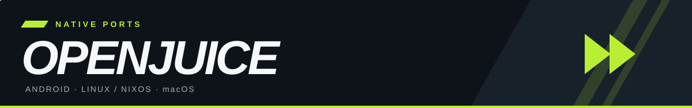
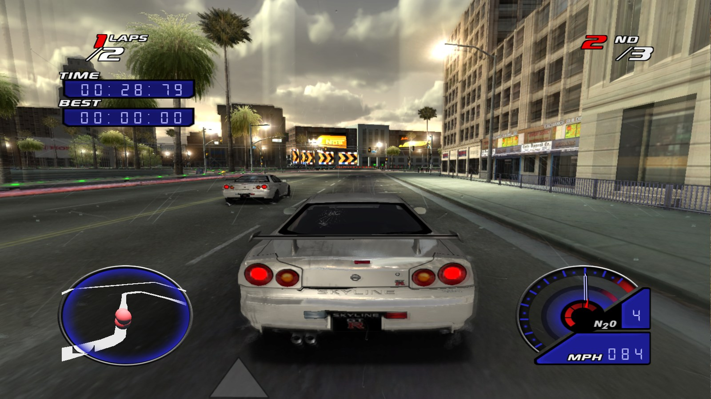
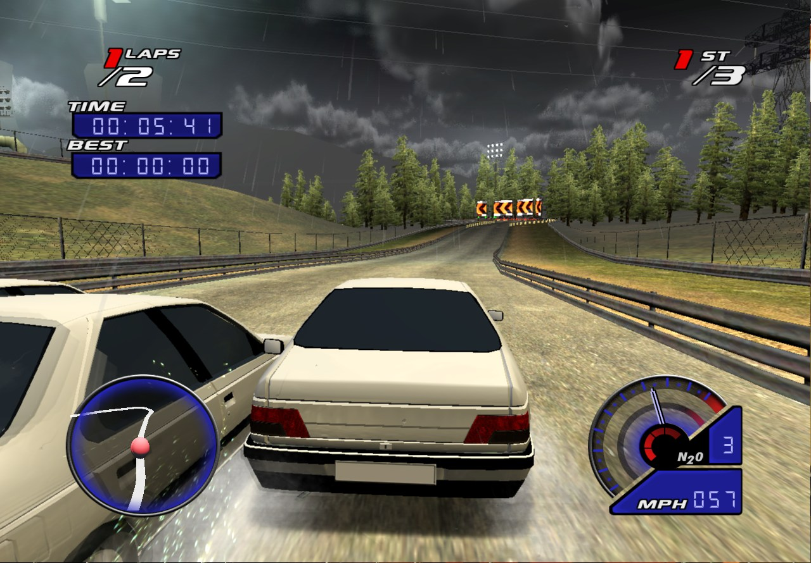
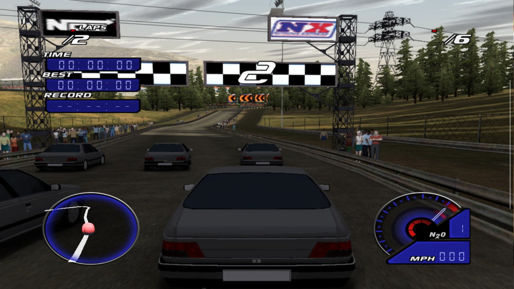
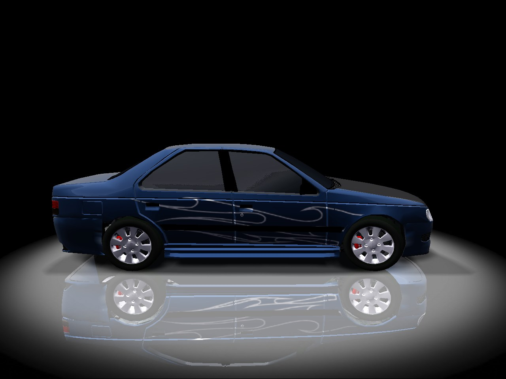
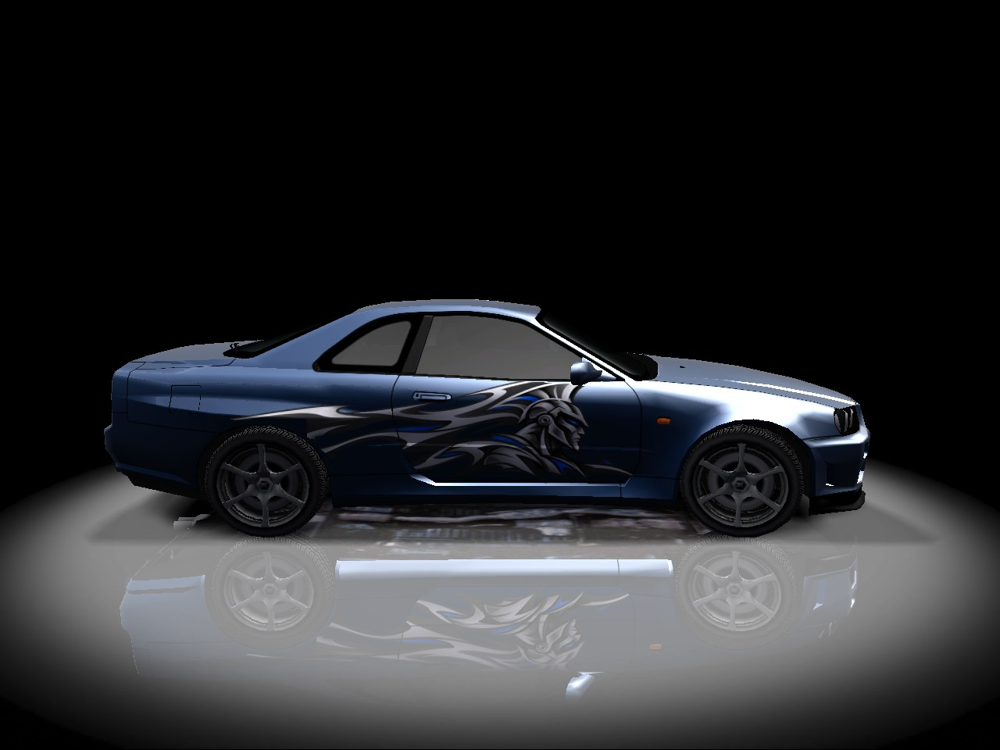
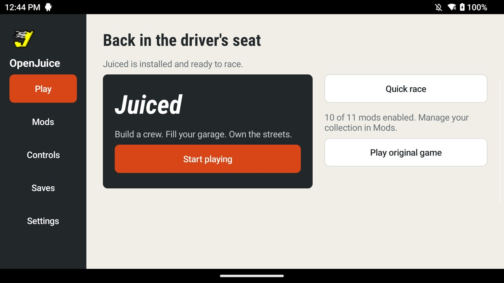
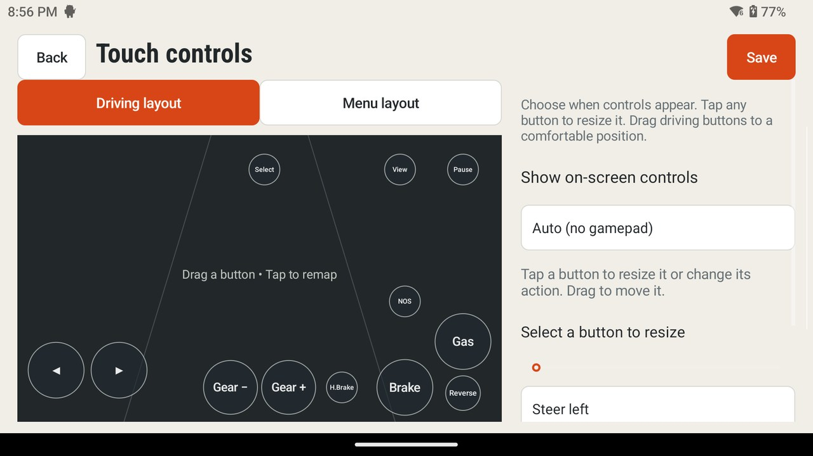
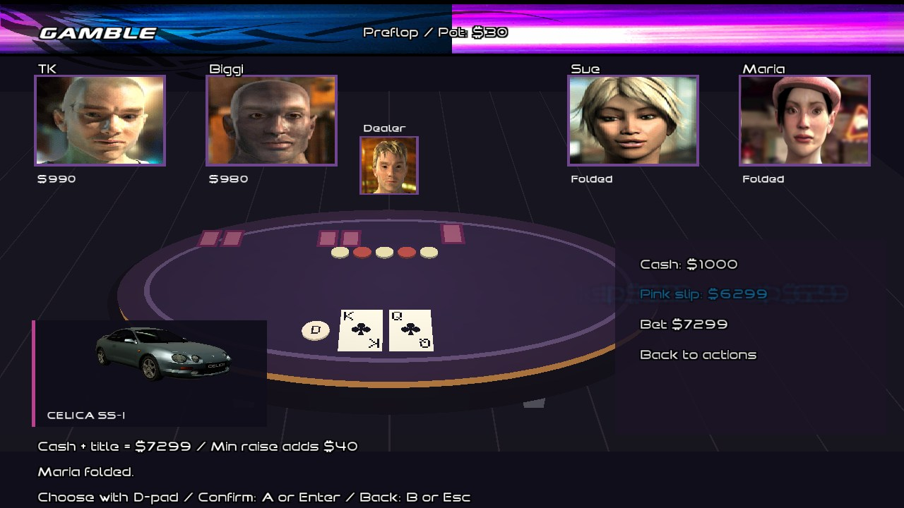

  

  <strong>Build your garage. Race your crew. Put the pink slip on the line.</strong> 
  Native ports of <a href="https://gitlab.com/sidecr3w/openjuice">OpenJuice</a>, the Juiced engine reconstructed by <strong>Sidewinder / sidecr3w</strong>. 
  Platform adaptations and optional mod integration maintained here by martin2844 and contributors.

  <a href="#get-started"><strong>Get started</strong></a> &nbsp;·&nbsp;
  <a href="#the-garage">The garage</a> &nbsp;·&nbsp;
  <a href="#android-in-your-hands">Android</a> &nbsp;·&nbsp;
  <a href="#under-the-hood">Build &amp; documentation</a> &nbsp;·&nbsp;
  <a href="https://gitlab.com/sidecr3w/openjuice">Upstream OpenJuice ↗</a>

Downtown Angel City · Skyline GT-R · native Linux capture

## Back to Angel City

Career racing, rival respect, crew orders, tuning and pink-slip stakes — powered by OpenJuice, with native **Metal** on macOS and **OpenGL / GLES** on Linux and Android. The shared source follows upstream **1.02.7** and keeps the optional car, livery and career additions in one codebase.

<table>
  <tr>
    <td width="50%" align="center">
       
      <strong>macOS · Metal</strong> 
      Rain, headlights and a night race in the installed Mac app.
    </td>
    <td width="50%" align="center">
       
      <strong>Android · Retroid Pocket 5</strong> 
      A direct screen capture from the handheld.
    </td>
  </tr>
</table>

## Get started

**Bring your own Juiced game data.** The engine, port and mod packages use the original game's assets; the game data itself is not bundled.

| Platform | Build the current 1.02.7 source | Earlier prebuilt download |
| :--- | :--- | :--- |
| **Android · ARM64** | [APK, import and controls guide](docs/android-port.md) | [1.02.5 · android.4](https://github.com/martin2844/juiced/releases/tag/android-v1.02.5-4) · Android 8+ |
| **Linux / NixOS · x86_64** | [Native build and Nix guide](docs/linux-port.md) | [1.02.5 · mods1](https://github.com/martin2844/juiced/releases/tag/linux-v1.02.5-mods1) · Nix package |
| **macOS · Apple Silicon** | [Build and package the app](docs/macos-build-and-run.md) | Current app validated locally; download not published yet |

The race captures show the current 1.02.7 source. The older Android/Linux downloads predate these renderer and mod updates. Development builds vary by device; no frame-rate target is guaranteed.

**On Android:** install the APK, import your `Juiced.zip` in the launcher and add optional mod ZIPs in **Mods**. **On desktop:** follow the platform guide, choose your game-data folder and enable the packages you want. The Mac's **Juiced Mod Garage** app launches the editable mod collection.

## The garage

Choose a stock build or load the optional collection: **11 additional cars**, body-kit options, wheels, neon, driver photos and custom logos. The everyday-car packs include the Peugeot 405 and 406, Golf R32, Jetta, Outback and Volvos, alongside the Integra DB8, BMW E36, Levin AE92 and Ferrari.

<table>
  <tr>
    <td width="50%" align="center">
       
      <strong>Peugeot 405 · optional body kit</strong> 
      The actual garage viewport, shown close up.
    </td>
    <td width="50%" align="center">
       
      <strong>Skyline GT-R · AI Hero Liveries</strong> 
      Five optional designs registered for the installed car collection.
    </td>
  </tr>
</table>

Packages live in [`mods/`](mods/README.md) and can be selected independently. Careers are shared across mod configurations. Catalogue validation and save checks are documented; visual quality and compatibility still vary by asset.

## Android, in your hands

Use a handheld's built-in gamepad, connect a controller or play with touch. Remap inputs, move the on-screen controls and resize each button individually. Touch controls can be disabled when you want the screen to yourself.

<table>
  <tr>
    <td width="50%" align="center">
       
      <strong>Your game, mods and saves</strong> 
      Game-data import, package management, backups and a career recovery editor.
    </td>
    <td width="50%" align="center">
       
      <strong>Your control layout</strong> 
      Individual button sizes, remapping and optional touch visibility.
    </td>
  </tr>
</table>

The physical Retroid Pocket 5 has been used for controller, import, save and renderer checks. See the [Android guide](docs/android-port.md) for setup.

## More ways to risk your ride

Optional career additions include hosting pink-slip races with eligible rivals, crew pink slips and **Texas Hold'em** for you and up to four rivals. At the table, mix cash with a car title valued as money, preview the car you are pledging and hear the game's recorded character reactions.

Optional career poker · native Linux capture using a test career

## Under the hood

The platform adapters use the OpenJuice engine and original game formats. Metal/GL rendering, SDL input/audio, Android imports and mod integration are maintained in this repository. All current platforms share the source on `main`.

- **Build:** [macOS](docs/macos-build-and-run.md) · [Linux/NixOS](docs/linux-port.md) · [Android](docs/android-port.md).
- **Mods:** [package guide](mods/README.md) · [Mac mod-app packaging](tools/mod_bundle/README.md).
- **Engine:** [upstream source](https://gitlab.com/sidecr3w/openjuice) · [upstream releases](https://gitlab.com/sidecr3w/openjuice/-/releases) · [integration notes](docs/upstream-sync.md).

<strong>Validation and screenshot provenance</strong>

The [3 November checkpoint](docs/native-effects-device-validation-2026-11-03.md) records 18 native GPU checks on both the physical RP5 and the Apple Silicon Mac, 730 Mac unit assertions, three Mac controls/reflection checks and day/night races. The Linux unit suite recorded 738 passes. These are targeted checks, not a complete career playthrough or a performance guarantee.

The Mac apps were built locally, bundled with their non-system libraries and ad-hoc signed. Intel hardware and Apple notarization have not been validated. MSAA is not advertised by the native renderer; supported effect paths include SMAA, lighting, shadows, clouds and heat haze.

Images are native runtime captures. The [image manifest](docs/media/captures.json) records their platforms, dates and hashes, including the earlier touch-editor capture. See [screenshot notes](docs/media/README.md) for details. The older `android` branch and historical releases remain available.

## Credits & license

**OpenJuice's engine reconstruction is Sidewinder's work.** This repository provides the native platform adaptations and optional integrations.

Required Notice: Copyright 2026 Sidewinder (https://gitlab.com/sidecr3w/openjuice)

The engine and port use the [PolyForm Noncommercial License 1.0.0](LICENSE.md). Dependencies and mod assets retain their respective licenses and attributions. Juiced and its game imagery belong to their respective rights holders.
